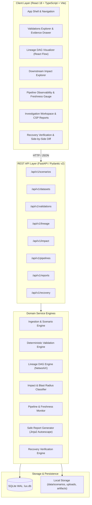

# Lux — Data Observability Platform

[](https://www.python.org/)
[](https://fastapi.tiangolo.com)
[](https://react.dev/)
[](https://www.typescriptlang.org/)
[](https://tailwindcss.com/)
[](https://www.docker.com/)
[]()

> **Lux** is an evidence-based data observability and quality validation platform built for data engineers, analytics engineers, and data consumers. It validates datasets, traces upstream-to-downstream lineage DAGs, quantifies blast radius impact, tracks pipeline execution vs. data quality health, and coordinates incident investigations with cryptographically verifiable reports.

---

## Table of Contents

- [Overview & Value Proposition](#overview--value-proposition)
- [System Architecture](#system-architecture)
- [The "Trace the Failure" Workflow](#the-trace-the-failure-workflow)
- [Signature Scenario: Monday Revenue Mystery](#signature-scenario-monday-revenue-mystery)
- [Quickstart Guide](#quickstart-guide)
  - [Option A: Docker Compose (Recommended)](#option-a-docker-compose-recommended)
  - [Option B: Local Development Setup](#option-b-local-development-setup)
- [Verification & Quality Assurance](#verification--quality-assurance)
- [Security & Architectural Safeguards](#security--architectural-safeguards)
- [Repository Directory Layout](#repository-directory-layout)
- [Documentation & Decision Records](#documentation--decision-records)

---

## Overview & Value Proposition

When data pipelines corrupt values, introduce duplicates, or silently miss partitions, traditional monitoring tools typically emit ambiguous alerts or fail to trigger because the ETL job exited with return code `0`. 

Lux addresses the fundamental gap in data pipeline reliability:

1. **Separation of Pipeline Health vs. Data Quality Health ([ADR-006](docs/decisions/ADR-006-separation-of-pipeline-health-and-data-quality.md)):** An ETL pipeline can succeed mechanically (`COMPLETED_SUCCESS`) while simultaneously producing corrupted data (`CORRUPTED`). Lux tracks compute exit codes and dataset health as two independent dimensions.
2. **Deterministic, Evidence-Based Validation:** Pure Python validation evaluators verify uniqueness, referential integrity, schema constraints, value ranges, and partition freshness without relying on black-box or non-deterministic AI models.
3. **Interactive Lineage & Blast Radius Analysis:** Traces directional dependency graphs via NetworkX and calculates exact downstream impact paths from root-cause datasets to executive reporting dashboards.
4. **Structured Incident Investigations & CSP Reports:** Seamless workspace linking observed facts, hypotheses, and action items, exported as immutable JSON and XSS-safe HTML reports with Content Security Policy headers.
5. **Recovery Verification:** Side-by-side run comparisons prove that upstream fixes resolve all validation failures and restore downstream data consumer trust (`ALL_ASSETS_HEALTHY`).

---

## System Architecture

Lux is designed as a **modular monolith** with zero external cloud dependencies. It runs completely self-contained with SQLite WAL mode and local filesystem storage.



---

## The "Trace the Failure" Workflow

Lux provides a disciplined 8-step investigative workflow:

```text
[1. Load Scenario] ──► [2. Execute Validations] ──► [3. Inspect Findings & Evidence] ──► [4. Trace Lineage DAG]
                                                                                                  │
[8. Verify Recovery] ◄── [7. Export Incident Report] ◄── [6. Dual-Dimension Pipeline] ◄── [5. Trace Impact]
```

1. **Load Scenario:** Mount bundled scenario fixtures (or user CSV/JSON uploads).
2. **Execute Validations:** Run declarative quality rules across datasets.
3. **Inspect Findings & Evidence:** Review structured failure evidence in a slide-over drawer with exact line numbers and affected record keys.
4. **Trace Lineage DAG:** Visualize the 16-node dependency graph with Dagre auto-layout.
5. **Trace Downstream Impact:** Select the failing root-cause node to highlight its blast radius across derived tables, metrics, and executive dashboards.
6. **Inspect Pipeline Observability:** Verify the dual-dimension anomaly (pipeline compute succeeded with exit code `0`, but data health is `CORRUPTED`).
7. **Coordinate Investigation & Export Report:** Synthesize findings into structured facts, hypotheses, and action items, exporting sanitized HTML and JSON reports.
8. **Verify Recovery:** Load corrected fixtures, re-execute validation rules, and observe the side-by-side diff confirming all 4 checks pass and downstream assets are healthy.

---

## Signature Scenario: Monday Revenue Mystery

The platform includes the deterministic signature scenario **Monday Revenue Mystery**:

> **Incident Briefing:** On Monday morning at 09:00 UTC, the executive revenue dashboard reports a sudden drop of \$42,000 compared to projections. The nightly data warehouse batch ETL reported `SUCCESS` (exit code 0), but business stakeholders observe contradictory metrics.

### Injected Data Quality Defects

| Rule ID | Category | Severity | Dataset | Observed Finding |
|---|---|---|---|---|
| `VAL-ORD-001` | Uniqueness | `CRITICAL` | `orders.csv` | **15 duplicate `order_id` values** causing double-counting in joins. |
| `VAL-ORD-002` | Referential Integrity | `HIGH` | `order_items.csv` | **24 orphaned items** referencing nonexistent `product_id` keys. |
| `VAL-INV-001` | Value Range | `HIGH` | `inventory.csv` | **8 negative inventory counts** (`quantity_on_hand < 0`). |
| `VAL-FRESH-001`| Freshness / Temporal Gap | `MEDIUM` | `orders.csv` | **4.47-hour ingestion gap** between Sunday 18:00 and 22:28 UTC. |

### Downstream Blast Radius

Selecting `orders.csv` or `VAL-ORD-001` isolates the downstream blast radius:
- `dim_orders` (`DIRECTLY_AFFECTED`)
- `agg_daily_revenue` (`POTENTIALLY_AFFECTED`)
- `Metric: Total Daily Revenue` (`POTENTIALLY_AFFECTED`)
- `Report: Executive Monday Dashboard` (`POTENTIALLY_AFFECTED`)

---

## Quickstart Guide

### Option A: Docker Compose (Recommended)

Run the full platform (FastAPI backend + React frontend + Nginx reverse proxy + SQLite WAL persistence) with a single command:

#### Prerequisites
- [Docker Desktop](https://www.docker.com/products/docker-desktop/) or Docker Engine 20.10+ & Docker Compose v2+.

#### Start the Stack
```bash
docker compose up --build
```

#### Access Points
| Service | URL | Description |
|---|---|---|
| **Web Frontend (UI)** | `http://localhost:3000` | Full interactive "Trace the Failure" interface |
| **Backend API** | `http://localhost:8000` | REST API service |
| **API Documentation** | `http://localhost:8000/api/v1/docs` | Interactive Swagger / OpenAPI UI |
| **Alternative Docs** | `http://localhost:8000/api/v1/redoc` | ReDoc API documentation |
| **Health Check** | `http://localhost:3000/health` | Service health status |

#### Stop the Stack
```bash
docker compose down -v
```

---

### Option B: Local Development Setup

If running locally without Docker:

#### 1. Backend (Python 3.13)
```bash
# Navigate to backend directory
cd backend

# Create and activate virtual environment
python -m venv .venv
# Windows PowerShell:
.venv\Scripts\Activate.ps1
# macOS / Linux:
source .venv/bin/activate

# Install backend dependencies with dev tools
pip install -e ".[dev]"

# Start development ASGI server
uvicorn app.main:app --reload --port 8000
```

#### 2. Frontend (Node.js 22 + React)
```bash
# Navigate to frontend directory in another terminal
cd frontend

# Install npm dependencies
npm install

# Start Vite development server (proxies /api to localhost:8000)
npm run dev
```

Open `http://localhost:3000` in your web browser.

---

## Verification & Quality Assurance

The codebase includes comprehensive test suites across backend engines, REST APIs, and frontend React components.

### Backend Verification (Python)

```bash
cd backend

# Run all 254 backend unit, integration, and scenario tests
pytest

# Run the signature scenario end-to-end acceptance test (< 2s execution)
pytest tests/scenarios/test_monday_revenue_mystery.py

# Linting with Ruff
ruff check .

# Formatter verification with Ruff
ruff format --check .

# Static type checking with Mypy (strict mode)
mypy app
```

### Frontend Verification (TypeScript & React)

```bash
cd frontend

# Run all 149 Vitest unit and component tests
npm test

# Static type checking with TypeScript compiler
npm run typecheck

# Code linting with ESLint flat config
npm run lint

# Compile optimized production bundle
npm run build
```

---

## Security & Architectural Safeguards

- **Untrusted File Ingestion Safeguards ([docs/security.md](docs/security.md)):** User dataset uploads are strictly capped at 20MB, validated for MIME and CSV/JSON signatures, and stored in isolated UUIDv4 directory structures with path canonicalization to prevent path traversal attacks.
- **XSS & Content Security Policy ([ADR-005](docs/decisions/ADR-005-safe-html-report-generation-and-sanitization.md)):** Exported HTML incident reports utilize Jinja2 strict auto-escaping, embedded inline CSS, and an immutable `<meta>` Content Security Policy tag (`default-src 'none'; style-src 'unsafe-inline'; img-src data:; sandbox;`). In-app report previews run inside a sandboxed iframe.
- **Zero Dynamic Code Execution:** Rules are declarative JSON specifications. The platform never evaluates arbitrary SQL, Python scripts, or template strings from user input.
- **SQLite WAL Concurrency ([ADR-004](docs/decisions/ADR-004-persistence-sqlite-wal-and-local-artifacts.md)):** Write-Ahead Logging (WAL) ensures multi-reader non-blocking concurrent reads during validation writes.
- **Container Resource Quotas:** Docker Compose enforces CPU limits (`1.0` core) and memory limits (`1024MB` backend, `512MB` frontend) to prevent starvation.

---

## Repository Directory Layout

```text
lux-data-observability/
├── AGENTS.md                          # Coding agent guidelines & operating protocol
├── README.md                          # Repository overview & quickstart (this file)
├── docker-compose.yml                 # Local container orchestration
├── .dockerignore                      # Build context exclusion rules
├── backend/                           # Python 3.13 / FastAPI application
│   ├── Dockerfile                     # Multi-stage Python 3.13 container build
│   ├── pyproject.toml                 # Dependencies, Ruff, Mypy, and Pytest configuration
│   ├── app/
│   │   ├── main.py                    # FastAPI entrypoint, lifespan & CORS
│   │   ├── api/v1/                    # Typed API routers (scenarios, validations, lineage, etc.)
│   │   ├── core/                      # Config (pydantic-settings), errors, logging
│   │   ├── db/                        # SQLite connection, session engine, init_db
│   │   ├── models/                    # SQLAlchemy persistence models (11 tables)
│   │   ├── schemas/                   # Pydantic v2 request/response schemas
│   │   └── services/                  # Core domain engines
│   │       ├── ingestion/             # CSV/JSON loaders, MIME sniffer, scenario service
│   │       ├── validation/            # Core, relational, temporal evaluators & runner
│   │       ├── lineage/               # NetworkX DAG engine, topological sort, layout
│   │       ├── impact/                # Downstream blast radius analyzer
│   │       ├── pipeline/              # Run history & freshness SLA monitor
│   │       ├── reports/               # Jinja2 autoescaping HTML & JSON report generator
│   │       └── recovery/              # Recovery verification engine & run comparison
│   └── tests/                         # Backend Pytest test suite (254 tests)
│       ├── unit/                      # Isolated service & evaluator unit tests
│       ├── integration/               # API endpoint & database integration tests
│       └── scenarios/                 # End-to-end scenario verification suite
├── frontend/                          # React 18+ / TypeScript / Vite application
│   ├── Dockerfile                     # Multi-stage Node 22 build + Nginx runtime
│   ├── nginx.conf                     # Production Nginx reverse-proxy & security headers
│   ├── package.json                   # Dependencies & npm scripts
│   ├── vite.config.ts                 # Bundler config & dev reverse proxy
│   ├── tsconfig.json                  # TypeScript compiler settings
│   ├── src/
│   │   ├── main.tsx                   # React root entrypoint
│   │   ├── App.tsx                    # Shell, scenario switcher, global health badges, tabs
│   │   ├── api/                       # Typed HTTP API client modules
│   │   ├── components/                # Reusable UI component modules
│   │   │   ├── common/                # Badges, cards, modals, tables, focus traps
│   │   │   ├── lineage/               # React Flow interactive DAG visualizer & node details
│   │   │   ├── validation/            # Summary cards, findings table & evidence drawer
│   │   │   ├── impact/                # Blast radius view & dependency path breakdown
│   │   │   ├── pipelines/             # Pipeline run timeline, step logs & freshness gauge
│   │   │   ├── reports/               # Investigation workspace & report export modal
│   │   │   └── recovery/              # Side-by-side run diff & recovery confirmation banner
│   │   ├── styles/                    # Lux Purple design tokens & Tailwind directives
│   │   └── types/                     # TypeScript domain models matching Pydantic schemas
│   └── tests/                         # Frontend Vitest test suite (149 tests)
├── data/                              # Bundled scenarios & runtime persistence
│   ├── scenarios/                     # Signature scenarios
│   │   └── monday_revenue_mystery/    # Scenario metadata, rules, history & fixtures
│   │       ├── scenario.json          # Lineage DAG & pipeline metadata
│   │       ├── rules.json             # Declarative validation rule definitions
│   │       ├── pipeline_history.json  # Historical ETL execution records
│   │       ├── defective/             # Fixtures containing 4 injected defects
│   │       └── corrected/             # Clean fixtures for recovery verification
│   ├── uploads/                       # User-uploaded datasets (.gitignored)
│   ├── artifacts/                     # Generated HTML/JSON report exports (.gitignored)
│   └── lux.db                         # SQLite database file (.gitignored)
└── docs/                              # Project technical documentation
    ├── product-requirements.md        # Full product specification (FR-01 to FR-09)
    ├── architecture.md                # System architecture, boundaries & data flow
    ├── implementation-plan.md         # Tasks T01-T24, DoR, DoD, and backlog specs
    ├── api-contracts.md               # Complete REST API contracts
    ├── data-model.md                  # Entity models & SQLite schema DDL
    ├── security.md                    # Threat model & security specifications
    ├── testing-strategy.md            # Testing pyramid & quality targets
    ├── progress.md                    # Live progress tracking across milestones
    └── decisions/                     # Architecture Decision Records (ADRs)
