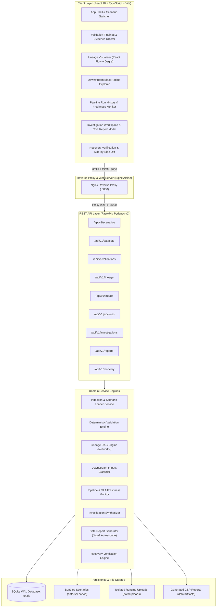

# LUX: Data Observability Platform

<p align="center">
  <a href="https://skillicons.dev">
    
  </a>
</p>

<p align="center">
  <a href="https://react.dev/"></a>
  <a href="https://www.typescriptlang.org/"></a>
  <a href="https://vite.dev/"></a>
  <a href="https://tailwindcss.com/"></a>
  <a href="https://reactflow.dev/"></a>
</p>
<p align="center">
  <a href="https://www.python.org/"></a>
  <a href="https://fastapi.tiangolo.com/"></a>
  <a href="https://www.sqlite.org/"></a>
  <a href="https://www.sqlalchemy.org/"></a>
  <a href="https://networkx.org/"></a>
</p>
<p align="center">
  <a href="https://www.docker.com/"></a>
  <a href="https://nginx.org/"></a>
  <a href="https://docs.pytest.org/"></a>
  <a href="https://vitest.dev/"></a>
</p>

> **LUX** is an evidence-based data observability and data quality validation platform built for data engineers, analytics engineers, and data consumers. It evaluates datasets against deterministic quality rules, maps multi-tier upstream-to-downstream lineage DAGs, quantifies blast radius impact on executive dashboards, disentangles pipeline execution success from underlying data corruption, and coordinates structured incident investigations with cryptographically verifiable audit reports.

---

## Table of Contents

- [Overview & Value Proposition](#overview--value-proposition)
- [Key Features](#key-features)
- [System Architecture](#system-architecture)
- [The "Trace the Failure" Workflow](#the-trace-the-failure-workflow)
- [Signature Scenario: Monday Revenue Mystery](#signature-scenario-monday-revenue-mystery)
- [Technology Stack](#technology-stack)
- [Getting Started](#getting-started)
  - [Prerequisites](#prerequisites)
  - [Option A: Docker Compose (Recommended)](#option-a-docker-compose-recommended)
  - [Option B: Local Development Setup](#option-b-local-development-setup)
- [Docker & Container Architecture](#docker--container-architecture)
  - [Starting the Container Stack](#starting-the-container-stack)
  - [Accessing the Application in Your Browser](#accessing-the-application-in-your-browser)
  - [Inspecting Service Health & Logs](#inspecting-service-health--logs)
  - [Stopping the Stack & Volume Management](#stopping-the-stack--volume-management)
- [Database & Data Management](#database--data-management)
  - [Database Schema & Table Initialization](#database-schema--table-initialization)
  - [Mandatory Seeding & Scenario Fixture Loading](#mandatory-seeding--scenario-fixture-loading)
  - [Repeatability, Idempotency & Data Safety](#repeatability-idempotency--data-safety)
  - [Persistence Across Restarts](#persistence-across-restarts)
  - [Reset & Verification Semantics](#reset--verification-semantics)
- [Configuration Reference](#configuration-reference)
- [Usage Guide & Primary API Endpoints](#usage-guide--primary-api-endpoints)
- [Testing & Quality Assurance](#testing--quality-assurance)
- [Security & Architectural Safeguards](#security--architectural-safeguards)
- [Repository Directory Layout](#repository-directory-layout)
- [Known Limitations & Roadmap](#known-limitations--roadmap)
- [Contributing & Development Workflow](#contributing--development-workflow)
- [License & Acknowledgments](#license--acknowledgments)

---

## Overview & Value Proposition

In production data platforms, the most dangerous data quality incidents are **silent failures**: an overnight batch ETL script exits cleanly with return code `0` (`SUCCESS`), while the resulting data warehouse tables contain duplicate primary keys, broken foreign-key references, out-of-range numerical anomalies, or missed temporal ingestion windows. Because traditional infrastructure monitoring only checks process exit codes and CPU metrics, business stakeholders often discover the corrupted metrics hours or days later on executive reporting dashboards.

**Lux** bridges this critical observability gap:

1. **Separation of Pipeline Health vs. Data Quality Health ([ADR-006](docs/decisions/ADR-006-separation-of-pipeline-health-and-data-quality.md)):** Lux treats compute status (`COMPLETED_SUCCESS`, `FAILED`) and dataset health (`HEALTHY`, `DEGRADED`, `CORRUPTED`) as two strictly independent operational dimensions. A pipeline run can execute without errors while generating corrupted data, and Lux surfaces this dual-dimension anomaly instantly.
2. **Deterministic, Evidence-Based Validation:** Pure Python validation engines evaluate dataset files against declarative specifications (uniqueness, referential integrity, schema adherence, numerical ranges, and partition freshness). Lux never relies on black-box or non-deterministic AI models to detect quality failures.
3. **Lineage DAG & Exact Blast Radius Quantification:** Backed by NetworkX and Dagre topological layout algorithms, Lux renders dependency graphs spanning raw ingestion files, staging tables, warehouse marts, BI metrics, and executive reports. When an upstream defect occurs, Lux calculates the exact downstream blast radius, classifying nodes as `DIRECTLY_AFFECTED` or `POTENTIALLY_AFFECTED`.
4. **Structured Incident Investigations & Cryptographically Verifiable CSP Reports:** A dedicated collaborative workspace lets engineers synthesize observed findings, document hypotheses, and track remediation action items. Investigations export to machine-readable JSON and air-gapped, XSS-safe HTML reports with Content Security Policy headers and SHA-256 integrity digests.
5. **Recovery Verification:** Side-by-side run comparisons prove that upstream fixes eliminate all validation findings and restore downstream consumer trust (`ALL_ASSETS_HEALTHY`).

---

## Key Features

| Capability | What It Does | Why It Matters | Status |
|---|---|---|---|
| **Deterministic Rule Evaluator** | Validates CSV/JSON datasets against uniqueness, referential integrity, value ranges, and partition freshness. | Eliminates false confidence; pinpoints exact row line numbers and offending values without fuzzy guesswork. | **Implemented** |
| **Dual-Dimension Health Tracking** | Tracks process execution exit codes alongside dataset quality states in independent indicators. | Detects silent pipeline corruption where the ETL batch script exited with `0` despite corrupt data. | **Implemented** |
| **Interactive Lineage DAG Visualizer** | Renders 16-node dependency graphs using React Flow with automated Dagre hierarchical coordinates. | Visualizes dependencies from raw ingest files to executive dashboards with zero manual graph positioning. | **Implemented** |
| **Downstream Blast Radius Tracer** | Traverses directed acyclic graphs (DAGs) to isolate derived models, metrics, and BI reports tainted by an upstream failure. | Eliminates manual Slack inquiries; shows engineers exactly which stakeholder reports cannot be trusted. | **Implemented** |
| **Partition Freshness & SLA Monitor** | Evaluates temporal ingestion gaps and checks actual vs. expected partition arrival intervals. | Alerts teams before business hours when nightly batch syncs stall or omit scheduled time slices. | **Implemented** |
| **Evidence Slide-Over Drawer** | Provides sample row inspections, line numbers, schema metadata, and direct "Trace Impact" shortcuts. | Reduces mean-time-to-investigate (MTTI) by keeping debugging evidence accessible in one click. | **Implemented** |
| **Investigation Workspace & CSP Reports** | Enforces separation between confirmed facts, hypotheses, and action items; exports immutable HTML/JSON reports. | Facilitates defensible post-mortems and audits without exposing the UI to cross-site scripting (XSS). | **Implemented** |
| **Recovery Verification Engine** | Compares defective baseline runs against corrected re-executions side-by-side. | Provides verifiable proof of resolution before closing an incident and unblocking downstream consumers. | **Implemented** |

---

## System Architecture

Lux is designed as a high-performance **modular monolith** with zero external cloud dependencies. It operates fully self-contained using an embedded SQLite database configured in Write-Ahead Logging (WAL) mode, local persistent storage, a FastAPI backend, and an Nginx-served React single-page application.



### Architectural Principles

1. **Strict Service Layer Boundaries:** Controllers in `backend/app/api/v1/` never execute raw database operations or file I/O directly. All business rules reside inside `backend/app/services/`.
2. **Typed Schemas:** Request payloads, response structures, and domain entities are strictly modeled using Pydantic v2 schemas on the backend and paired TypeScript interfaces on the frontend.
3. **Safe Concurrency with SQLite WAL:** Database connections enable SQLite Write-Ahead Logging (`PRAGMA journal_mode=WAL`), allowing concurrent readers to query lineage and validation states while background tasks write run records.

---

## The "Trace the Failure" Workflow

Lux is built around a standardized 8-step investigative workflow that takes an engineer from alert to verified recovery:

```text
[1. Load Scenario] ──────► [2. Execute Validations] ──────► [3. Inspect Findings & Evidence] ──────► [4. Trace Lineage DAG]
                                                                                                              │
[8. Verify Recovery] ◄─── [7. Export Incident Report] ◄─── [6. Dual-Dimension Pipeline] ◄─── [5. Trace Impact]
```

1. **Load Scenario:** Mount the bundled scenario fixtures or ingest a custom multi-table dataset.
2. **Execute Validations:** Run the declarative quality rules across all target datasets in parallel.
3. **Inspect Findings & Evidence:** Review structured failure findings in a slide-over drawer, including exact CSV row indices and offending sample keys.
4. **Trace Lineage DAG:** Open the 16-node dependency graph to visualize how source files flow into intermediate staging models, marts, and dashboards.
5. **Trace Downstream Impact:** Select the failing root-cause node to highlight its exact blast radius across derived tables, metrics, and executive reports.
6. **Inspect Pipeline Observability:** Confirm the dual-dimension anomaly where ETL batch compute completed with return code `0` (`COMPLETED_SUCCESS`), yet the dataset health is flagged as `CORRUPTED`.
7. **Coordinate Investigation & Export Report:** Record findings, test hypotheses, track action items, and export an immutable, XSS-safe HTML and JSON report.
8. **Verify Recovery:** Re-run the validation engine against corrected fixtures to verify side-by-side that all findings are resolved and downstream assets have returned to `HEALTHY`.

---

## Signature Scenario: Monday Revenue Mystery

Lux includes a built-in, deterministic signature scenario modeled on a real-world enterprise data pipeline failure:

> **Incident Briefing:** On Monday morning at 09:00 UTC, the executive revenue dashboard indicates an unexpected **\$42,000 drop** in daily revenue. The overnight warehouse batch ETL reported `SUCCESS` (exit code `0`, duration 142s), but finance stakeholders report conflicting figures.

### Injected Data Quality Defects

| Rule ID | Category | Severity | Target Dataset | Observed Defect & Metric Impact |
|---|---|---|---|---|
| `VAL-ORD-001` | Uniqueness | `CRITICAL` | `orders.csv` | **15 duplicate `order_id` records** in raw ingestion (1,250 total rows), leading to inflated revenue projections and corrupted joins. |
| `VAL-ORD-002` | Referential Integrity | `HIGH` | `order_items.csv` | **24 orphaned item records** referencing nonexistent `product_id` keys in `products.csv`. |
| `VAL-INV-001` | Value Range | `HIGH` | `inventory.csv` | **8 negative inventory counts** (`quantity_on_hand < 0`), violating physical inventory constraints. |
| `VAL-FRESH-001`| Freshness / Temporal Gap | `MEDIUM` | `orders.csv` | **4.47-hour ingestion gap** on Sunday between 18:00 and 22:28 UTC, causing missing transaction records in the morning warehouse batch. |

### Downstream Blast Radius

Selecting `orders.csv` or rule `VAL-ORD-001` traces the failure across the dependency graph:

```text
orders.csv [ROOT CAUSE: CORRUPTED]
   └── dim_orders [DIRECTLY_AFFECTED]
         └── agg_daily_revenue [POTENTIALLY_AFFECTED]
               └── Metric: Total Daily Revenue [POTENTIALLY_AFFECTED]
                     └── Report: Executive Monday Dashboard [POTENTIALLY_AFFECTED]
```

---

## Technology Stack

### Core Technologies

| Technology | Layer / Role | Version | Engineering Rationale |
|---|---|---|---|
| **Python** | Backend Runtime | `3.13` | Modern typing semantics, fast execution, robust standard library. |
| **FastAPI** | Backend Web Framework | `0.115+` | High-throughput asynchronous routing, automatic OpenAPI specification generation. |
| **Pydantic v2** | Schema Validation | `2.10+` | Rust-backed deserialization and strict request/response data contracts. |
| **SQLite (WAL)** | Relational Persistence | `3.x` | Zero-configuration embedded ACID database with multi-reader concurrency via Write-Ahead Logging. |
| **SQLAlchemy** | ORM & Query Layer | `2.0+` | Explicit declarative mappings, connection pooling, and transactional integrity across 11 models. |
| **NetworkX** | Lineage Graph Engine | `3.0+` | In-memory directed acyclic graph (DAG) traversal, topological sorting, and cycle detection. |
| **Jinja2** | Report Generation | `3.1+` | Strict auto-escaping template engine generating standalone HTML audit reports. |
| **React** | Frontend UI Framework | `18.3+` | Declarative component model with strict render separation and concurrent features. |
| **TypeScript** | Frontend Language | `5.7+` | End-to-end type safety matching backend Pydantic API schemas. |
| **Vite** | Frontend Build Tool | `6.1+` | Instant Hot Module Replacement (HMR) and optimized ES module production bundling. |
| **React Flow (@xyflow/react)** | Lineage DAG Visualizer | `12.12+` | Production-grade canvas supporting customizable dual-status nodes, zoom, pan, and edge routing. |
| **Tailwind CSS** | Styling & Design System | `3.4+` | Utility-first CSS using the custom Lux Purple brand palette and WCAG AA accessible contrast tokens. |
| **Docker & Docker Compose** | Container Orchestration | `Compose v2` | Hermetic local deployment orchestrating backend, frontend, and persistent volume mounts. |
| **Nginx** | Production Web Gateway | `Alpine` | High-efficiency static SPA file serving, security headers, and reverse proxying to FastAPI. |

### Development & Testing Tools

| Tool | Role | Configuration / Command |
|---|---|---|
| **Pytest** | Backend Test Framework | `pytest` (254 tests, async-enabled via `pytest-asyncio`) |
| **Vitest** | Frontend Test Framework | `npm test` (162 tests, jsdom environment) |
| **Ruff** | Python Linter & Formatter | `ruff check .` and `ruff format --check .` (line-length 100) |
| **Mypy** | Python Type Checker | `mypy app` (strict mode, 0 errors across 64 source files) |
| **ESLint** | JavaScript / TypeScript Linter | `npm run lint` (flat config with react-hooks and typescript-eslint) |

---

## Getting Started

### Prerequisites

Verify that your system meets the minimum requirements:

- **Option A (Containerized):** [Docker Desktop](https://www.docker.com/products/docker-desktop/) 20.10+ with Docker Compose v2+.
- **Option B (Local Bare-Metal):**
  - **Python:** `3.11+` (tested on `3.13.5`)
  - **Node.js:** `18+` or `20 LTS+` (tested on `v22.17.1` with npm `10.8.2`)
  - **Git:** `2.30+`

---

### Option A: Docker Compose (Recommended)

Docker Compose starts the entire platform—FastAPI backend, React frontend, Nginx reverse proxy, and SQLite WAL database—in isolated containers with a single command.

```bash
# 1. Clone the repository
git clone https://github.com/your-username/lux-data-observability.git
cd lux-data-observability

# 2. Build and start the container stack
docker compose up --build
```

Once Docker reports that both containers are healthy, open your browser:
👉 **[http://localhost:3000](http://localhost:3000)**

*(For full details on browser commands, service logs, and volume cleanup, see [Docker & Container Architecture](#docker--container-architecture)).*

---

### Option B: Local Development Setup

If you prefer to run the backend and frontend directly on your host machine without Docker:

#### 1. Backend Service (FastAPI)

```bash
# Navigate to the backend directory
cd backend

# Create an isolated virtual environment
python -m venv .venv

# Activate the virtual environment
# Windows (PowerShell):
.venv\Scripts\Activate.ps1
# macOS / Linux:
source .venv/bin/activate

# Install the backend package with development dependencies
pip install -e ".[dev]"

# (Optional) Verify table initialization manually
python -m app.db.init_db

# Start the ASGI development server
uvicorn app.main:app --reload --port 8000
```

The backend server is now running at `http://localhost:8000`. Database tables and required directories are initialized automatically on startup.

#### 2. Frontend Application (React + Vite)

Open a second terminal window:

```bash
# Navigate to the frontend directory
cd frontend

# Install dependencies strictly according to package lock
npm install

# Start the Vite development server
npm run dev
```

The Vite development server will start on port `3000` (or `5173`) and automatically proxy all `/api/*` network requests to `http://localhost:8000`.

---

## Docker & Container Architecture

### Starting the Container Stack

The provided `docker-compose.yml` configures two coordinated services connected via an internal bridge network (`lux-network`):

```bash
docker compose up --build
```

To run in detached background mode:

```bash
docker compose up --build -d
```

### Accessing the Application in Your Browser

Once the containers are initialized, access the application interfaces using the following verified URLs:

| Service | Host URL | Description |
|---|---|---|
| **Web Frontend (UI)** | **[`http://localhost:3000`](http://localhost:3000)** | Interactive Lux application shell, lineage visualizer, and evidence drawer |
| **Backend REST API** | **[`http://localhost:8000`](http://localhost:8000)** | FastAPI service entrypoint |
| **Interactive API Docs** | **[`http://localhost:8000/api/v1/docs`](http://localhost:8000/api/v1/docs)** | Swagger / OpenAPI UI for executing live API requests |
| **Alternative API Docs** | **[`http://localhost:8000/api/v1/redoc`](http://localhost:8000/api/v1/redoc)** | ReDoc formatted API specifications |
| **System Health Check** | **[`http://localhost:3000/health`](http://localhost:3000/health)** | Nginx-proxied backend health check returning `{"status":"ok","app":"lux"}` |

#### Opening Directly from the Terminal

You can launch the web application in your default browser using your operating system's native command:

- **Windows (PowerShell):**
  ```powershell
  Start-Process http://localhost:3000
  ```
- **macOS:**
  ```bash
  open http://localhost:3000
  ```
- **Linux:**
  ```bash
  xdg-open http://localhost:3000
  ```

#### What You Will See Upon Opening

1. The Lux Purple dashboard loads with the active **Monday Revenue Mystery** scenario.
2. The global header immediately displays the **Dual-Dimension Health Status**:
   - Compute Execution: **`SUCCESS`** (Batch finished with return code `0`).
   - Data Quality Health: **`CORRUPTED`** (4 failing checks detected).
3. The navigation tabs (`Validations`, `Lineage`, `Impact Analysis`, `Pipelines`, `Investigation`, `Recovery`) allow full interactive exploration of the failure.

### Inspecting Service Health & Logs

Both containers include configured Docker health checks (`urllib.request` on Python backend, `wget` on Nginx frontend) with resource quotas (1.0 CPU, 1024MB RAM backend, 512MB RAM frontend).

To inspect running containers and health status:

```bash
docker compose ps
```

To view streaming logs from both services:

```bash
docker compose logs -f
```

To stream logs from a specific service:

```bash
docker compose logs -f backend
docker compose logs -f frontend
```

### Stopping the Stack & Volume Management

To stop running containers while **preserving** all database records, validation runs, and uploaded datasets:

```bash
docker compose down
```

To stop containers and **completely reset** the environment (removes the persistent volume mount and local runtime state):

```bash
docker compose down -v
```

---

## Database & Data Management

### Database Schema & Table Initialization

Lux uses SQLite with Write-Ahead Logging (`WAL` mode) for reliable local persistence. The relational schema consists of **11 tables** managed via SQLAlchemy declarative models:

1. `scenarios`: Scenario definitions and active fixture version tracking (`defective` vs. `corrected`).
2. `datasets`: Registered CSV/JSON datasets with file paths, sizes, row counts, and column counts.
3. `validation_rules`: Declarative quality rules (uniqueness, referential integrity, range, freshness).
4. `validation_runs`: Historical records of rule validation execution batches.
5. `validation_findings`: Granular failure records with severity, rule category, line numbers, and sample keys.
6. `lineage_nodes`: 16 multi-tier dependency nodes (source files, staging models, marts, metrics, dashboards).
7. `lineage_edges`: 18 directional dependency edges connecting upstream assets to downstream consumers.
8. `pipeline_runs`: Historical ETL execution runs tracking compute status vs. data quality health.
9. `freshness_checks`: Partition freshness SLA evaluations and temporal gap metrics.
10. `investigations`: Structured post-mortem workspaces tracking facts, hypotheses, and action items.
11. `report_artifacts`: Generated HTML and JSON report metadata with SHA-256 integrity hashes.

#### Automatic Table Initialization
Tables are created automatically on backend startup via the FastAPI `lifespan` handler (`backend/app/main.py`), which calls `init_db()` (`Base.metadata.create_all`). 

To run table initialization manually outside the web server:
```bash
cd backend
python -m app.db.init_db
```

---

### Mandatory Seeding & Scenario Fixture Loading

Lux implements an evidence-based seeding mechanism built around bundled scenario fixtures.

#### 1. Seed Implementation & Data Sources
Seed fixtures reside in `data/scenarios/monday_revenue_mystery/`:
- `scenario.json`: Scenario metadata, 4 dataset schemas, 16 lineage nodes, and 18 lineage edges.
- `rules.json`: 4 quality validation rules (`VAL-ORD-001`, `VAL-ORD-002`, `VAL-INV-001`, `VAL-FRESH-001`).
- `pipeline_history.json`: 10 historical pipeline execution runs and 1 partition freshness SLA record.
- `defective/`: Raw CSV files containing the 4 injected defects (`orders.csv`, `order_items.csv`, `inventory.csv`, `products.csv`).
- `corrected/`: Clean CSV files for recovery verification.

The seed logic is implemented in `backend/app/services/ingestion/loader.py` within `ScenarioLoaderService.load_scenario()`.

#### 2. Exact Seeding Commands
Seeding is executed via the REST API, through Python, or directly from the frontend UI:

- **Via REST API (cURL):**
  ```bash
  # Load the defective baseline scenario
  curl -X POST http://localhost:8000/api/v1/scenarios/monday_revenue_mystery/load \
    -H "Content-Type: application/json" \
    -d '{"fixture_version": "defective"}'

  # Or load the clean corrected scenario for recovery testing
  curl -X POST http://localhost:8000/api/v1/scenarios/monday_revenue_mystery/load \
    -H "Content-Type: application/json" \
    -d '{"fixture_version": "corrected"}'
  ```

- **Via Python CLI:**
  ```bash
  cd backend
  python -c "from app.db.session import SessionLocal; from app.services.ingestion.loader import ScenarioLoaderService; db=SessionLocal(); ScenarioLoaderService.load_scenario('monday_revenue_mystery', 'defective', db)"
  ```

- **Via Web UI:** Click the **Scenario Switcher** dropdown in the header, select **Monday Revenue Mystery**, and click **Load Scenario**.

#### 3. Execution Order
1. Table schemas must exist first (automatically handled by `init_db()` during startup).
2. The application server must be running if using the REST API or UI; Python scripts can seed offline.

#### 4. Prerequisites
- A writable directory path configured via `LUX_DATA_DIR` (defaults to `./data`).
- Bundled scenario files present in `data/scenarios/monday_revenue_mystery/`.

#### 5. Initial Data Created
- **1 Scenario:** `monday_revenue_mystery`
- **4 Datasets:** 1,250 order rows, 3,420 order items, 250 products, 250 inventory records.
- **4 Validation Rules:** Covering uniqueness, referential integrity, range limits, and freshness.
- **16 Lineage Nodes & 18 Lineage Edges:** Constructing the full dependency DAG.
- **10 Historical Pipeline Runs:** Demonstrating historical trends and the overnight dual-status anomaly.
- **Demo Credentials:** None. Lux does not require user accounts or store secrets.

---

### Repeatability, Idempotency & Data Safety

- **Full Idempotency:** Seeding is completely repeatable. When `load_scenario` runs, it issues cascading `delete` statements for all existing scenario-scoped records (`ValidationFinding`, `ValidationRun`, `ReportArtifact`, `Investigation`, `FreshnessCheck`, `PipelineRun`, `LineageEdge`, `LineageNode`, `ValidationRule`, `Dataset`) before inserting the new records.
- **Data Safety:** Seeding only replaces database records belonging to the target `scenario_id`. **It never alters or overwrites the underlying CSV/JSON fixture files on disk.**

---

### Persistence Across Restarts

- Database records are stored on disk at `data/lux.db`.
- In Docker Compose, the host `./data` folder is mounted into the container at `/app/data`.
- **Seeded data survives container restarts and image rebuilds.** Data is only removed if the user explicitly executes `docker compose down -v` or manually deletes `data/lux.db`.

---

### Reset & Verification Semantics

To verify that seeding completed successfully:

```bash
# Verify via API: Check dataset and rule counts
curl http://localhost:8000/api/v1/scenarios/monday_revenue_mystery
```

**Expected JSON Response:**
```json
{
  "id": "monday_revenue_mystery",
  "name": "Monday Revenue Mystery",
  "active_fixture_version": "defective",
  "dataset_count": 4,
  "rule_count": 4,
  "is_bundled": true
}
```

---

## Configuration Reference

Lux is configured using environment variables prefixed with `LUX_`. In Docker Compose, these variables are passed in `docker-compose.yml`. For local development, you can create a `.env` file in the `backend/` directory or export them directly in your shell.

| Environment Variable | Description | Required? | Default Value | Example Value |
|---|---|---|---|---|
| `LUX_ENV` | Application environment (`development`, `test`, `production`) | No | `development` | `production` |
| `LUX_LOG_LEVEL` | Logging verbosity (`DEBUG`, `INFO`, `WARNING`, `ERROR`) | No | `INFO` | `INFO` |
| `LUX_DATA_DIR` | Absolute or relative root directory for database, uploads, and reports | No | `./data` (relative to repo root) | `/app/data` |
| `LUX_DATABASE_URL` | Custom SQLAlchemy database connection URL (overrides default SQLite path) | No | `None` (derived from `sqlite:///<LUX_DATA_DIR>/lux.db`) | `sqlite:////var/data/lux.db` |
| `LUX_CORS_ORIGINS` | Permitted Cross-Origin Resource Sharing (CORS) origins | No | `http://localhost:3000,http://127.0.0.1:3000` | `http://localhost:3000` |
| `LUX_MAX_UPLOAD_SIZE_BYTES` | Maximum allowed file upload size for custom datasets | No | `20971520` (20 MB) | `20971520` |

---

## Usage Guide & Primary API Endpoints

### 1. Load the Defective Scenario
Load the scenario to populate SQLite with the defective baseline:

```bash
curl -X POST http://localhost:8000/api/v1/scenarios/monday_revenue_mystery/load \
  -H "Content-Type: application/json" \
  -d '{"fixture_version": "defective"}'
```

### 2. Execute Data Quality Validations
Run the validation engine across all loaded rules:

```bash
curl -X POST http://localhost:8000/api/v1/validations/run \
  -H "Content-Type: application/json" \
  -d '{"scenario_id": "monday_revenue_mystery"}'
```

**Response (Summary):**
```json
{
  "scenario_id": "monday_revenue_mystery",
  "status": "COMPLETED",
  "total_rules": 4,
  "passed_rules": 0,
  "failed_rules": 4,
  "quality_health": "CORRUPTED"
}
```

### 3. Trace Downstream Blast Radius
Identify which business assets are affected by the corrupted `orders.csv` table:

```bash
curl -X POST http://localhost:8000/api/v1/impact/trace \
  -H "Content-Type: application/json" \
  -d '{"scenario_id": "monday_revenue_mystery", "source_node_id": "src_orders"}'
```

**Response (Summary):**
```json
{
  "source_node_id": "src_orders",
  "affected_nodes_count": 4,
  "paths_count": 1,
  "affected_nodes": [
    {"node_id": "dim_orders", "classification": "DIRECTLY_AFFECTED"},
    {"node_id": "agg_daily_revenue", "classification": "POTENTIALLY_AFFECTED"},
    {"node_id": "metric_revenue", "classification": "POTENTIALLY_AFFECTED"},
    {"node_id": "report_exec_dash", "classification": "POTENTIALLY_AFFECTED"}
  ]
}
```

### 4. Verify Recovery
Re-evaluate the pipeline against corrected fixtures to verify resolution:

```bash
curl -X POST http://localhost:8000/api/v1/recovery/verify \
  -H "Content-Type: application/json" \
  -d '{"scenario_id": "monday_revenue_mystery"}'
```

**Response (Summary):**
```json
{
  "recovery_confirmed": true,
  "resolved_findings_count": 4,
  "remaining_findings_count": 0,
  "new_quality_health": "HEALTHY",
  "downstream_status": "ALL_ASSETS_HEALTHY"
}
```

---

## Testing & Quality Assurance

The Lux platform enforces rigorous quality assurance across both backend engines and frontend components.

```text
       ▲
      / \       1 Signature Scenario E2E Test Suite (9 multi-stage tests)
     /───\      ---------------------------------------------------------
    /     \     24 Integration Tests (API Endpoints, SQLite Transactions, Uploads)
   /───────\    ------------------------------------------------------------------
  /         \   382 Unit Tests (Evaluators, DAG Traversals, React Components, Hooks)
 ─────────────
```

### Backend Test Suite (Python)

```bash
cd backend

# Run all 254 backend tests
pytest

# Run the master scenario acceptance test (< 2s execution)
pytest tests/scenarios/test_monday_revenue_mystery.py

# Static type checking in strict mode (0 errors across 64 files)
mypy app

# Code linting
ruff check .

# Code formatting verification
ruff format --check .
```

### Frontend Test Suite (TypeScript & React)

```bash
cd frontend

# Run all 162 Vitest component and API client tests
npm test

# Static type check with TypeScript compiler (0 errors)
npm run typecheck

# Code linting with ESLint flat configuration
npm run lint

# Production bundle compilation
npm run build
```

**Verified Test Summary:**
- **Backend:** 254 passed in ~15.7s (100% pass rate).
- **Frontend:** 162 passed in ~18.8s (31 test files, 100% pass rate).
- **Total:** **416 automated tests passed.**

---

## Security & Architectural Safeguards

- **Untrusted File Ingestion Safeguards ([docs/security.md](docs/security.md)):** User uploads are strictly limited to 20MB (`LUX_MAX_UPLOAD_SIZE_BYTES`), validated against binary magic bytes and CSV/JSON MIME types, and stored in isolated UUIDv4 directory trees. Path traversal attacks (`../`) are detected and rejected with `400 Bad Request`.
- **XSS Prevention & Content Security Policy ([ADR-005](docs/decisions/ADR-005-safe-html-report-generation-and-sanitization.md)):** Exported HTML incident reports utilize Jinja2 auto-escaping for all dynamic fields, embed inline Lux Purple styling, and enforce an immutable Content Security Policy:
  ```http
  Content-Security-Policy: default-src 'none'; style-src 'unsafe-inline'; img-src data:; sandbox;
  ```
  In-app report previews are rendered inside sandboxed iframes (`sandbox="allow-same-origin"`).
- **Zero Dynamic Code Execution:** All data quality rules are declarative JSON specifications. The platform never evaluates dynamic SQL queries, Python scripts, or template strings from user input.
- **Non-Root Container Execution:** The backend Docker container creates and executes under a dedicated non-root user (`lux:lux`, UID 1000).
- **Resource Limits:** Docker Compose enforces CPU limits (`1.0`) and memory limits (`1024MB` backend, `512MB` frontend) to prevent memory exhaustion.

---

## Repository Directory Layout

```text
lux-data-observability/
├── AGENTS.md                          # Coding agent guidelines & operating protocol
├── README.md                          # Repository overview & quickstart (this file)
├── docker-compose.yml                 # Local container orchestration specification
├── .dockerignore                      # Build context exclusion rules
├── backend/                           # Python 3.13 / FastAPI application
│   ├── Dockerfile                     # Multi-stage Python 3.13 container build
│   ├── pyproject.toml                 # Dependencies, Ruff, Mypy, and Pytest configuration
│   ├── app/
│   │   ├── main.py                    # FastAPI entrypoint, lifespan & CORS
│   │   ├── api/v1/                    # Typed API routers (scenarios, validations, lineage, etc.)
│   │   ├── core/                      # Config (pydantic-settings), errors, logging
│   │   ├── db/                        # SQLite connection, session engine, init_db
│   │   ├── models/                    # SQLAlchemy persistence models (11 tables)
│   │   ├── schemas/                   # Pydantic v2 request/response schemas
│   │   └── services/                  # Core domain engines
│   │       ├── ingestion/             # CSV/JSON loaders, MIME sniffer, scenario service
│   │       ├── validation/            # Core, relational, temporal evaluators & runner
│   │       ├── lineage/               # NetworkX DAG engine, topological sort, layout
│   │       ├── impact/                # Downstream blast radius analyzer
│   │       ├── pipeline/              # Run history & freshness SLA monitor
│   │       ├── reports/               # Jinja2 autoescaping HTML & JSON report generator
│   │       └── recovery/              # Recovery verification engine & run comparison
│   └── tests/                         # Backend Pytest test suite (254 tests)
│       ├── unit/                      # Isolated service & evaluator unit tests
│       ├── integration/               # API endpoint & database integration tests
│       └── scenarios/                 # End-to-end scenario verification suite
├── frontend/                          # React 18+ / TypeScript / Vite application
│   ├── Dockerfile                     # Multi-stage Node 22 build + Nginx runtime
│   ├── nginx.conf                     # Production Nginx reverse-proxy & security headers
│   ├── package.json                   # Dependencies & npm scripts
│   ├── vite.config.ts                 # Bundler config & dev reverse proxy
│   ├── tsconfig.json                  # TypeScript compiler settings
│   ├── src/
│   │   ├── main.tsx                   # React root entrypoint
│   │   ├── App.tsx                    # Shell, scenario switcher, global health badges, tabs
│   │   ├── api/                       # Typed HTTP API client modules
│   │   ├── components/                # Reusable UI component modules
│   │   │   ├── common/                # Badges, cards, modals, tables, focus traps
│   │   │   ├── lineage/               # React Flow interactive DAG visualizer & node details
│   │   │   ├── validation/            # Summary cards, findings table & evidence drawer
│   │   │   ├── impact/                # Blast radius view & dependency path breakdown
│   │   │   ├── pipeline/              # Pipeline run timeline, step logs & freshness gauge
│   │   │   ├── reports/               # Investigation workspace & report export modal
│   │   │   └── recovery/              # Side-by-side run diff & recovery confirmation banner
│   │   ├── styles/                    # Lux Purple design tokens & Tailwind directives
│   │   └── types/                     # TypeScript domain models matching Pydantic schemas
│   └── tests/                         # Frontend Vitest test suite (162 tests)
├── data/                              # Bundled scenarios & runtime persistence
│   ├── scenarios/                     # Signature scenarios
│   │   └── monday_revenue_mystery/    # Scenario metadata, rules, history & fixtures
│   │       ├── scenario.json          # Lineage DAG & pipeline metadata
│   │       ├── rules.json             # Declarative validation rule definitions
│   │       ├── pipeline_history.json  # Historical ETL execution records
│   │       ├── defective/             # Fixtures containing 4 injected defects
│   │       └── corrected/             # Clean fixtures for recovery verification
│   ├── uploads/                       # User-uploaded datasets (.gitignored)
│   ├── artifacts/                     # Generated HTML/JSON report exports (.gitignored)
│   └── lux.db                         # SQLite database file (.gitignored)
└── docs/                              # Project technical documentation
    ├── product-requirements.md        # Full product specification (FR-01 to FR-09)
    ├── architecture.md                # System architecture, boundaries & data flow
    ├── implementation-plan.md         # Tasks T01-T24, DoR, DoD, and backlog specs
    ├── api-contracts.md               # Complete REST API contracts
    ├── data-model.md                  # Entity models & SQLite schema DDL
    ├── security.md                    # Threat model & security specifications
    ├── testing-strategy.md            # Testing pyramid & quality targets
    ├── progress.md                    # Live progress tracking across milestones
    └── decisions/                     # Architecture Decision Records (ADRs)
```

---

## Known Limitations & Roadmap

While Lux is fully operational for local observability and scenario investigations, the following characteristics represent deliberate architectural trade-offs:

- **Single-Node Embedded Storage:** Persistence is built around SQLite WAL mode and local disk storage. Future enhancements will introduce pluggable cloud object store adapters (AWS S3, Google Cloud Storage) and PostgreSQL for multi-region cluster deployments.
- **Batch-Oriented Validation:** Current evaluators operate on file-based CSV and JSON batches. Real-time streaming validation (Apache Kafka topics, Apache Flink streams) is planned for future milestones.
- **Authentication & RBAC:** Lux currently operates without multi-user authentication or role-based access control (RBAC), assuming an internal team or single-tenant developer deployment.
- **Distributed Compute:** Validation checks execute in pure Python in-process. Integrating distributed computation engines (e.g., DuckDB, Polars, or PySpark) for multi-gigabyte files is on the technical roadmap.

---

## Contributing & Development Workflow

Contributions from data engineers, analytics engineers, and open-source contributors are welcome.

### Pre-Commit Checklist
Before submitting a pull request, ensure all linters, type checkers, and test suites pass with zero warnings or errors:

```bash
# 1. Backend Linting, Formatting, and Typing
cd backend
ruff check .
ruff format --check .
mypy app
pytest

# 2. Frontend Linting, Typing, and Unit Tests
cd ../frontend
npm run lint
npm run typecheck
npm test
npm run build
```

### Git Conventions
- Maintain focused, atomic commits following conventional commit syntax (`feat:`, `fix:`, `docs:`, `test:`, `refactor:`).
- Preserve existing docstrings, strict type annotations, and architectural boundaries between layers.

---

## License & Acknowledgments

### License
This project is open-source and distributed under the terms of the **MIT License**.

### Acknowledgments
Lux is built upon remarkable open-source software:
- [FastAPI](https://fastapi.tiangolo.com/) & [Starlette](https://www.starlette.io/) by Sebastián Ramírez
- [React](https://react.dev/) by the React team at Meta
- [React Flow (@xyflow/react)](https://reactflow.dev/) by xyflow
- [Pydantic](https://docs.pydantic.dev/) by Samuel Colvin and contributors
- [NetworkX](https://networkx.org/) for graph analysis algorithms
- [Tailwind CSS](https://tailwindcss.com/) by Tailwind Labs
