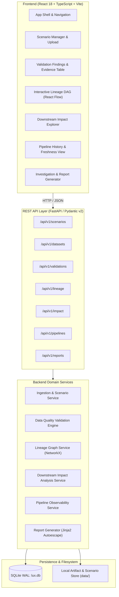
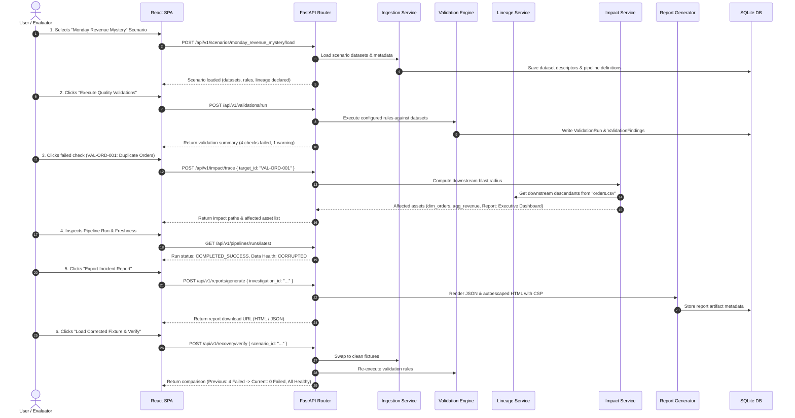

# Lux Architecture Specification

## 1. Architectural Style: Modular Monolith

Lux is architected as a **Modular Monolith** designed for high clarity, deterministic execution, and zero-cost local operations. It separates backend domain concerns into isolated service packages communicating through strictly typed interfaces and Pydantic schemas, with a responsive React Single Page Application (SPA) on the client side.



---

## 2. Component Boundaries & Responsibilities

### 2.1 Ingestion & Scenario Management (`backend/app/services/ingestion`)
- **Responsibilities:**
  - Locate, parse, and load bundled scenarios from `data/scenarios/`.
  - Handle user uploads of CSV and JSON files, verifying headers, encoding (UTF-8), and MIME type.
  - Enforce upload constraints: maximum file size (20MB), valid file extension, filename sanitization.
  - Store uploaded files into isolated, UUID-namespaced directories in `data/uploads/`.
  - Extract and cache dataset metadata: column list, inferred types, record counts, null counts.
- **Dependencies:** Filesystem storage, SQLite metadata tables. Does not depend on the validation engine or lineage directly.

### 2.2 Data Quality Validation Engine (`backend/app/services/validation`)
- **Responsibilities:**
  - Parse declarative validation rule configurations (`rules.json` or database rule records).
  - Execute checks deterministically against dataset records using stream-based chunking.
  - Produce structured `ValidationFinding` records with full context: rule ID, category, severity, status, affected record count, and sample row keys.
  - Record execution duration and timestamp per rule check.
  - Support rule categories: Null/Required values, Uniqueness, Referential Integrity, Value Ranges, Regex Patterns, Temporal Checks, Schema Mismatches, and Freshness.
- **Dependencies:** Ingestion service (for reading datasets), SQLite persistence (for storing run findings).

### 2.3 Lineage & Graph Service (`backend/app/services/lineage`)
- **Responsibilities:**
  - Build and maintain an in-memory Directed Acyclic Graph (DAG) using NetworkX.
  - Ingest explicit node and edge definitions declared in scenario metadata.
  - Enforce DAG constraints: reject graphs with cycles or dangling node references.
  - Provide fast graph queries: upstream ancestors, downstream descendants, topological order, and direct dependencies.
  - Convert internal graph representations into React Flow compatible node and edge payloads with Dagre-calculated layout positions.
- **Dependencies:** SQLite lineage records. Completely decoupled from UI rendering.

### 2.4 Downstream Impact Analysis Engine (`backend/app/services/impact`)
- **Responsibilities:**
  - Given a target entity (a failed validation check, a dataset, or a pipeline asset), trace all downstream paths through the lineage DAG.
  - Classify affected assets into distinct impact tiers:
    - `CONFIRMED_FAILED`: The asset failed its own validations.
    - `DIRECTLY_AFFECTED`: Direct downstream consumer of corrupted data.
    - `POTENTIALLY_AFFECTED`: Transitive downstream consumer in the dependency chain.
    - `HEALTHY`: No failing upstream dependencies.
  - Generate clear, human-readable dependency path explanations (e.g., `orders.csv -> transform_orders -> agg_revenue -> Report`).
- **Dependencies:** Lineage service, Validation service.

### 2.5 Pipeline Observability Service (`backend/app/services/pipeline`)
- **Responsibilities:**
  - Record and query pipeline execution runs: start/finish times, duration, return codes, execution status (`COMPLETED_SUCCESS`, `FAILED`), and record throughput.
  - Track dataset partition freshness against declared SLA expectations.
  - Enforce the separation between **execution health** (job exited successfully) and **data quality health** (job produced valid data).
  - Maintain historical metrics for run duration trends and anomaly detection.
- **Dependencies:** SQLite persistence.

### 2.6 Incident Investigation & Report Generator (`backend/app/services/reports`)
- **Responsibilities:**
  - Combine validation findings, lineage paths, impact blast radius, and pipeline execution logs into a unified investigation entity.
  - Generate reproducible, immutable reports in both **JSON** and **HTML** formats.
  - Enforce security: Jinja2 auto-escaping, strict Content Security Policy (CSP), inlined CSS styling, and zero external JavaScript execution.
  - Save generated report files in `data/artifacts/` and track their hash in SQLite.
- **Dependencies:** All upstream services (Validation, Lineage, Impact, Pipeline).

---

## 3. Data Flow: The "Trace the Failure" Execution Pipeline



---

## 4. Frontend Architecture

### 4.1 Component Hierarchy
- **`AppShell`**: Header with Lux Purple branding, navigation, scenario switcher, global status indicator.
- **`ScenarioSelector`**: Dropdown for bundled scenarios + drag-and-drop file upload modal.
- **`ValidationView`**:
  - `SummaryCards`: Total checks, passed, failed, warnings, duration.
  - `FindingsTable`: Filterable list by dataset, severity, status, search.
  - `EvidenceDrawer`: Slide-over panel displaying row keys, observed vs expected values, affected line numbers.
- **`LineageView`**:
  - `ReactFlowCanvas`: Interactive zoom/pan DAG rendering.
  - `CustomNodes`: Node cards styled by asset type with dual status badges (Compute vs Quality).
  - `PathHighlighter`: Highlights active upstream and downstream paths on node hover or selection.
- **`ImpactView`**:
  - `BlastRadiusTree`: Collapsible tree of impacted derived tables, metrics, and reports.
  - `PathExplanationCard`: Step-by-step breakdown of how the failure propagates.
- **`PipelineView`**:
  - `RunHistoryTimeline`: Execution duration bar charts and status chips.
  - `FreshnessGauge`: Visual representation of expected partition SLA vs observed timestamp.
- **`ReportModal`**:
  - Tabbed preview of generated JSON and sanitized HTML report with direct download buttons.
- **`RecoveryDiffView`**:
  - Side-by-side comparison table of Before (Defective) vs After (Corrected) validation runs.

### 4.2 Design Tokens & Lux Purple Theme
Lux uses a disciplined, engineering-grade color palette:
- **Brand Primary:** Lux Purple (`#6B46C1` base, `#7C3AED` hover, `#553C9A` active).
- **Backgrounds:** Slate Dark (`#0F172A`), Card Dark (`#1E293B`), Border Slate (`#334155`), Light Canvas (`#F8FAFC`).
- **Semantic Statuses (Always paired with text & icons):**
  - Success / Healthy: Emerald (`#10B981`)
  - Warning: Amber (`#F59E0B`)
  - Failed / Corrupted: Rose (`#F43F5E`)
  - Neutral / Unvalidated: Slate (`#64748B`)
- **Typography:** Inter or system monospace for code, numbers, and identifiers to ensure technical legibility.

---

## 5. Storage & Persistence Layout

```text
data/
├── lux.db                     # SQLite database file (WAL mode enabled)
├── scenarios/                 # Deterministic bundled scenario fixtures
│   └── monday_revenue_mystery/
│       ├── scenario.json      # Lineage DAG and pipeline metadata
│       ├── rules.json         # Declarative quality rules
│       ├── pipeline_history.json
│       ├── defective/         # Raw CSV fixtures with defects
│       │   ├── orders.csv
│       │   ├── order_items.csv
│       │   ├── products.csv
│       │   └── inventory.csv
│       └── corrected/         # Clean CSV fixtures for recovery
│           ├── orders.csv
│           ├── order_items.csv
│           ├── products.csv
│           └── inventory.csv
├── uploads/                   # Uploaded user datasets (UUID directories)
└── artifacts/                 # Generated JSON & HTML incident reports
```

---

## 6. Containerization & Local Orchestration

The platform is orchestrated via `docker-compose.yml`:
- **`backend` service:** Python 3.13 image running Uvicorn on port 8000. Mounts `./data` for persistent SQLite storage.
- **`frontend` service:** Node 22 build served via Nginx reverse proxy on port 3000, forwarding `/api/*` requests to the backend container.
- **Zero Cloud Footprint:** Requires zero external SaaS, cloud credentials, or database containers.

