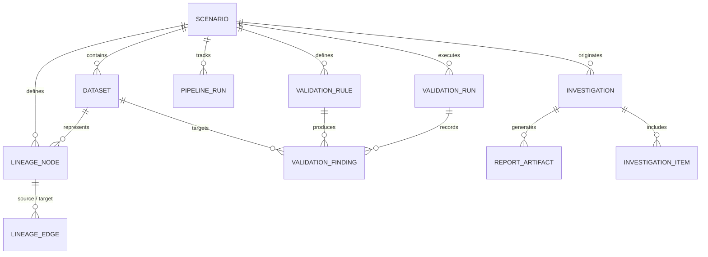

# Lux Data Model & Schema Specification

## 1. Entity-Relationship Overview

Lux uses a relational schema persisted in SQLite (`data/lux.db`). The core entities capture scenarios, datasets, validation rules, validation execution runs, granular findings, lineage graph nodes and edges, pipeline runs, and generated reports.



---

## 2. Core Enumerations & Vocabularies

### 2.1 Severity Levels (`Severity`)
- `CRITICAL`: Causes immediate pipeline stoppage, invalid business reports, or data corruption (e.g., duplicate primary keys, broken referential integrity).
- `HIGH`: Major data discrepancy requiring investigation (e.g., negative inventory, extreme distribution shifts).
- `MEDIUM`: Noticeable anomaly or delayed freshness not yet breaking downstream consumers.
- `LOW`: Minor cosmetic anomaly or minor formatting discrepancy.
- `INFO`: Informational check or baseline metric recording.

### 2.2 Validation Statuses (`ValidationStatus`)
- `PASSED`: Check executed and all records satisfied the rule.
- `FAILED`: Check executed and one or more records violated the rule.
- `WARNING`: Non-fatal failure threshold reached.
- `SKIPPED`: Rule was bypassed (e.g., required column was missing).
- `ERROR`: Rule execution threw an unhandled runtime error.

### 2.3 Rule Categories (`RuleCategory`)
- `NULL_CHECK`: Null or blank checks on required fields.
- `UNIQUENESS`: Primary key and composite unique key checks.
- `TYPE_VALIDITY`: Data type conformance, format, and enum validity.
- `REFERENTIAL_INTEGRITY`: Foreign key existence across datasets.
- `TEMPORAL_ANOMALY`: Timestamp parsing, future timestamps, and temporal gaps.
- `SCHEMA_INTEGRITY`: Column existence, extra columns, type mismatch.
- `RECORD_COUNT`: Expected row counts and count ratios.
- `VALUE_RANGE`: Min/max numeric or date ranges.
- `FRESHNESS`: Partition arrival recency vs SLA expectation.

### 2.4 Pipeline Execution Status (`PipelineExecutionStatus`)
- `COMPLETED_SUCCESS`: Process completed with return code 0.
- `COMPLETED_WITH_WARNINGS`: Process completed with non-fatal warnings.
- `FAILED`: Process crashed or exited with non-zero code.
- `RUNNING`: Process is actively executing.
- `CANCELLED`: Execution was terminated by user or timeout.

### 2.5 Data Quality Health (`DataQualityHealth`)
- `HEALTHY`: 100% of executed checks passed.
- `WARNING`: Only LOW/MEDIUM warnings detected.
- `DEGRADED`: HIGH severity issues present.
- `CORRUPTED`: CRITICAL severity issues present (e.g., primary key collapse).
- `UNVALIDATED`: No checks executed yet.

### 2.6 Lineage Node Types (`LineageNodeType`)
- `SOURCE_DATASET`: Ingested file or source table.
- `TRANSFORMATION`: Processing script, SQL query, or dbt model.
- `DERIVED_DATASET`: Cleaned, joined, or intermediate table.
- `METRIC`: Aggregated business calculation or KPI.
- `REPORT`: Consumer dashboard, executive email, or visualization.

### 2.7 Asset Impact Status (`AssetImpactStatus`)
- `CONFIRMED_FAILED`: The asset itself directly failed a validation rule.
- `DIRECTLY_AFFECTED`: Direct child of a confirmed failed asset.
- `POTENTIALLY_AFFECTED`: Downstream transitive descendant in dependency path.
- `HEALTHY`: Passing checks or no upstream failures.

---

## 3. Relational Schema (SQLite DDL)

```sql
-- Scenarios Table
CREATE TABLE scenarios (
    id TEXT PRIMARY KEY,
    name TEXT NOT NULL,
    description TEXT,
    category TEXT NOT NULL DEFAULT 'synthetic',
    is_bundled BOOLEAN NOT NULL DEFAULT 1,
    active_fixture_version TEXT NOT NULL DEFAULT 'defective', -- 'defective' or 'corrected'
    created_at TIMESTAMP NOT NULL DEFAULT CURRENT_TIMESTAMP,
    updated_at TIMESTAMP NOT NULL DEFAULT CURRENT_TIMESTAMP
);

-- Datasets Table
CREATE TABLE datasets (
    id TEXT PRIMARY KEY,
    scenario_id TEXT NOT NULL,
    name TEXT NOT NULL,
    file_path TEXT NOT NULL,
    file_format TEXT NOT NULL, -- 'csv' or 'json'
    file_size_bytes INTEGER NOT NULL,
    record_count INTEGER NOT NULL DEFAULT 0,
    column_count INTEGER NOT NULL DEFAULT 0,
    schema_definition TEXT NOT NULL, -- JSON array of column metadata
    created_at TIMESTAMP NOT NULL DEFAULT CURRENT_TIMESTAMP,
    FOREIGN KEY (scenario_id) REFERENCES scenarios(id) ON DELETE CASCADE
);
CREATE INDEX idx_datasets_scenario ON datasets(scenario_id);

-- Validation Rules Table
CREATE TABLE validation_rules (
    id TEXT PRIMARY KEY,
    scenario_id TEXT NOT NULL,
    dataset_id TEXT NOT NULL,
    name TEXT NOT NULL,
    category TEXT NOT NULL,
    severity TEXT NOT NULL,
    parameters TEXT NOT NULL, -- JSON object specifying rule config
    is_active BOOLEAN NOT NULL DEFAULT 1,
    created_at TIMESTAMP NOT NULL DEFAULT CURRENT_TIMESTAMP,
    FOREIGN KEY (scenario_id) REFERENCES scenarios(id) ON DELETE CASCADE,
    FOREIGN KEY (dataset_id) REFERENCES datasets(id) ON DELETE CASCADE
);
CREATE INDEX idx_rules_scenario ON validation_rules(scenario_id);
CREATE INDEX idx_rules_dataset ON validation_rules(dataset_id);

-- Validation Runs Table
CREATE TABLE validation_runs (
    id TEXT PRIMARY KEY,
    scenario_id TEXT NOT NULL,
    fixture_version TEXT NOT NULL, -- 'defective' or 'corrected'
    status TEXT NOT NULL, -- 'PASSED', 'FAILED', 'WARNING'
    total_checks INTEGER NOT NULL DEFAULT 0,
    passed_checks INTEGER NOT NULL DEFAULT 0,
    failed_checks INTEGER NOT NULL DEFAULT 0,
    warning_checks INTEGER NOT NULL DEFAULT 0,
    skipped_checks INTEGER NOT NULL DEFAULT 0,
    error_checks INTEGER NOT NULL DEFAULT 0,
    execution_duration_ms INTEGER NOT NULL,
    executed_at TIMESTAMP NOT NULL DEFAULT CURRENT_TIMESTAMP,
    FOREIGN KEY (scenario_id) REFERENCES scenarios(id) ON DELETE CASCADE
);
CREATE INDEX idx_val_runs_scenario ON validation_runs(scenario_id);

-- Validation Findings Table
CREATE TABLE validation_findings (
    id TEXT PRIMARY KEY,
    run_id TEXT NOT NULL,
    rule_id TEXT NOT NULL,
    dataset_id TEXT NOT NULL,
    rule_category TEXT NOT NULL,
    severity TEXT NOT NULL,
    status TEXT NOT NULL,
    affected_fields TEXT NOT NULL, -- JSON array of field names
    affected_record_count INTEGER NOT NULL DEFAULT 0,
    total_record_count INTEGER NOT NULL DEFAULT 0,
    message TEXT NOT NULL,
    evidence TEXT NOT NULL, -- JSON object containing sample rows, key IDs, observed vs expected
    execution_duration_ms INTEGER NOT NULL,
    created_at TIMESTAMP NOT NULL DEFAULT CURRENT_TIMESTAMP,
    FOREIGN KEY (run_id) REFERENCES validation_runs(id) ON DELETE CASCADE,
    FOREIGN KEY (rule_id) REFERENCES validation_rules(id) ON DELETE CASCADE,
    FOREIGN KEY (dataset_id) REFERENCES datasets(id) ON DELETE CASCADE
);
CREATE INDEX idx_findings_run ON validation_findings(run_id);
CREATE INDEX idx_findings_rule ON validation_findings(rule_id);
CREATE INDEX idx_findings_dataset ON validation_findings(dataset_id);

-- Lineage Nodes Table
CREATE TABLE lineage_nodes (
    id TEXT PRIMARY KEY,
    scenario_id TEXT NOT NULL,
    name TEXT NOT NULL,
    node_type TEXT NOT NULL, -- 'SOURCE_DATASET', 'TRANSFORMATION', 'DERIVED_DATASET', 'METRIC', 'REPORT'
    dataset_id TEXT, -- Nullable if transformation, metric, or report
    owner TEXT,
    description TEXT,
    metadata TEXT, -- JSON blob with SQL query, logic, refresh cadence
    FOREIGN KEY (scenario_id) REFERENCES scenarios(id) ON DELETE CASCADE,
    FOREIGN KEY (dataset_id) REFERENCES datasets(id) ON DELETE SET NULL
);
CREATE INDEX idx_nodes_scenario ON lineage_nodes(scenario_id);

-- Lineage Edges Table
CREATE TABLE lineage_edges (
    id TEXT PRIMARY KEY,
    scenario_id TEXT NOT NULL,
    source_id TEXT NOT NULL,
    target_id TEXT NOT NULL,
    dependency_type TEXT NOT NULL DEFAULT 'DIRECT_INPUT',
    FOREIGN KEY (scenario_id) REFERENCES scenarios(id) ON DELETE CASCADE,
    FOREIGN KEY (source_id) REFERENCES lineage_nodes(id) ON DELETE CASCADE,
    FOREIGN KEY (target_id) REFERENCES lineage_nodes(id) ON DELETE CASCADE
);
CREATE INDEX idx_edges_scenario ON lineage_edges(scenario_id);
CREATE INDEX idx_edges_source ON lineage_edges(source_id);
CREATE INDEX idx_edges_target ON lineage_edges(target_id);

-- Pipeline Runs Table
CREATE TABLE pipeline_runs (
    id TEXT PRIMARY KEY,
    scenario_id TEXT NOT NULL,
    pipeline_name TEXT NOT NULL,
    execution_status TEXT NOT NULL, -- 'COMPLETED_SUCCESS', 'FAILED'
    quality_health TEXT NOT NULL,   -- 'HEALTHY', 'CORRUPTED', etc.
    start_time TIMESTAMP NOT NULL,
    end_time TIMESTAMP NOT NULL,
    duration_ms INTEGER NOT NULL,
    records_ingested INTEGER NOT NULL DEFAULT 0,
    records_written INTEGER NOT NULL DEFAULT 0,
    error_message TEXT,
    run_log TEXT, -- JSON array of execution step logs
    created_at TIMESTAMP NOT NULL DEFAULT CURRENT_TIMESTAMP,
    FOREIGN KEY (scenario_id) REFERENCES scenarios(id) ON DELETE CASCADE
);
CREATE INDEX idx_pipeline_runs_scenario ON pipeline_runs(scenario_id);

-- Freshness Checks Table
CREATE TABLE freshness_checks (
    id TEXT PRIMARY KEY,
    scenario_id TEXT NOT NULL,
    dataset_id TEXT NOT NULL,
    expected_partition_timestamp TIMESTAMP NOT NULL,
    observed_partition_timestamp TIMESTAMP,
    sla_hours INTEGER NOT NULL,
    status TEXT NOT NULL, -- 'FRESH', 'STALE', 'MISSING'
    checked_at TIMESTAMP NOT NULL DEFAULT CURRENT_TIMESTAMP,
    FOREIGN KEY (scenario_id) REFERENCES scenarios(id) ON DELETE CASCADE,
    FOREIGN KEY (dataset_id) REFERENCES datasets(id) ON DELETE CASCADE
);

-- Investigations & Incident Reports Table
CREATE TABLE investigations (
    id TEXT PRIMARY KEY,
    scenario_id TEXT NOT NULL,
    title TEXT NOT NULL,
    status TEXT NOT NULL DEFAULT 'OPEN', -- 'OPEN', 'INVESTIGATING', 'RECOVERED'
    initial_finding_id TEXT,
    verified_facts TEXT NOT NULL, -- JSON array of observed facts
    hypotheses TEXT NOT NULL,     -- JSON array of hypotheses
    action_items TEXT NOT NULL,   -- JSON array of remediation items
    created_at TIMESTAMP NOT NULL DEFAULT CURRENT_TIMESTAMP,
    updated_at TIMESTAMP NOT NULL DEFAULT CURRENT_TIMESTAMP,
    FOREIGN KEY (scenario_id) REFERENCES scenarios(id) ON DELETE CASCADE,
    FOREIGN KEY (initial_finding_id) REFERENCES validation_findings(id) ON DELETE SET NULL
);

-- Report Artifacts Table
CREATE TABLE report_artifacts (
    id TEXT PRIMARY KEY,
    investigation_id TEXT NOT NULL,
    scenario_id TEXT NOT NULL,
    validation_run_id TEXT NOT NULL,
    format TEXT NOT NULL, -- 'json' or 'html'
    file_path TEXT NOT NULL,
    sha256_hash TEXT NOT NULL,
    file_size_bytes INTEGER NOT NULL,
    generated_at TIMESTAMP NOT NULL DEFAULT CURRENT_TIMESTAMP,
    FOREIGN KEY (investigation_id) REFERENCES investigations(id) ON DELETE CASCADE,
    FOREIGN KEY (scenario_id) REFERENCES scenarios(id) ON DELETE CASCADE,
    FOREIGN KEY (validation_run_id) REFERENCES validation_runs(id) ON DELETE CASCADE
);
CREATE INDEX idx_reports_investigation ON report_artifacts(investigation_id);
```

---

## 4. Scenario Metadata Schema (`scenario.json`)

The bundled scenario `monday_revenue_mystery` is defined via a declarative `scenario.json`:

```json
{
  "id": "monday_revenue_mystery",
  "name": "Monday Revenue Mystery",
  "description": "Daily revenue metrics report unexpected spikes following a successful overnight pipeline run.",
  "category": "e-commerce",
  "version": "1.0.0",
  "datasets": [
    {
      "id": "orders",
      "name": "orders.csv",
      "format": "csv",
      "defective_path": "defective/orders.csv",
      "corrected_path": "corrected/orders.csv",
      "expected_record_count": 1250,
      "columns": [
        {"name": "order_id", "type": "string", "nullable": false},
        {"name": "customer_id", "type": "string", "nullable": false},
        {"name": "order_date", "type": "timestamp", "nullable": false},
        {"name": "order_status", "type": "string", "nullable": false},
        {"name": "total_amount", "type": "float", "nullable": false}
      ]
    },
    {
      "id": "order_items",
      "name": "order_items.csv",
      "format": "csv",
      "defective_path": "defective/order_items.csv",
      "corrected_path": "corrected/order_items.csv",
      "expected_record_count": 3420,
      "columns": [
        {"name": "item_id", "type": "string", "nullable": false},
        {"name": "order_id", "type": "string", "nullable": false},
        {"name": "product_id", "type": "string", "nullable": false},
        {"name": "quantity", "type": "integer", "nullable": false},
        {"name": "unit_price", "type": "float", "nullable": false}
      ]
    },
    {
      "id": "products",
      "name": "products.csv",
      "format": "csv",
      "defective_path": "defective/products.csv",
      "corrected_path": "corrected/products.csv",
      "expected_record_count": 250,
      "columns": [
        {"name": "product_id", "type": "string", "nullable": false},
        {"name": "sku", "type": "string", "nullable": false},
        {"name": "category", "type": "string", "nullable": false},
        {"name": "base_price", "type": "float", "nullable": false}
      ]
    },
    {
      "id": "inventory",
      "name": "inventory.csv",
      "format": "csv",
      "defective_path": "defective/inventory.csv",
      "corrected_path": "corrected/inventory.csv",
      "expected_record_count": 250,
      "columns": [
        {"name": "sku", "type": "string", "nullable": false},
        {"name": "warehouse_id", "type": "string", "nullable": false},
        {"name": "quantity_on_hand", "type": "integer", "nullable": false},
        {"name": "last_updated", "type": "timestamp", "nullable": false}
      ]
    }
  ],
  "lineage": {
    "nodes": [
      {"id": "src_orders", "name": "orders.csv", "type": "SOURCE_DATASET", "dataset_id": "orders"},
      {"id": "src_order_items", "name": "order_items.csv", "type": "SOURCE_DATASET", "dataset_id": "order_items"},
      {"id": "src_products", "name": "products.csv", "type": "SOURCE_DATASET", "dataset_id": "products"},
      {"id": "src_inventory", "name": "inventory.csv", "type": "SOURCE_DATASET", "dataset_id": "inventory"},
      {"id": "tf_orders", "name": "transform_clean_orders", "type": "TRANSFORMATION", "metadata": {"engine": "SQL"}},
      {"id": "tf_items", "name": "transform_order_line_items", "type": "TRANSFORMATION", "metadata": {"engine": "SQL"}},
      {"id": "tf_inventory", "name": "transform_inventory_snapshot", "type": "TRANSFORMATION", "metadata": {"engine": "Python"}},
      {"id": "tf_revenue", "name": "aggregate_daily_revenue", "type": "TRANSFORMATION", "metadata": {"engine": "SQL"}},
      {"id": "dim_orders", "name": "dim_orders", "type": "DERIVED_DATASET"},
      {"id": "fct_order_items", "name": "fct_order_items", "type": "DERIVED_DATASET"},
      {"id": "dim_inventory", "name": "dim_inventory", "type": "DERIVED_DATASET"},
      {"id": "agg_daily_revenue", "name": "agg_daily_revenue", "type": "DERIVED_DATASET"},
      {"id": "metric_revenue", "name": "Metric: Total Daily Revenue", "type": "METRIC"},
      {"id": "metric_inventory", "name": "Metric: Inventory Health Ratio", "type": "METRIC"},
      {"id": "report_exec_dash", "name": "Report: Executive Monday Dashboard", "type": "REPORT"},
      {"id": "report_stock_alert", "name": "Report: Warehouse Stock Alert", "type": "REPORT"}
    ],
    "edges": [
      {"source": "src_orders", "target": "tf_orders"},
      {"source": "tf_orders", "target": "dim_orders"},
      {"source": "src_order_items", "target": "tf_items"},
      {"source": "src_products", "target": "tf_items"},
      {"source": "tf_items", "target": "fct_order_items"},
      {"source": "src_inventory", "target": "tf_inventory"},
      {"source": "tf_inventory", "target": "dim_inventory"},
      {"source": "dim_orders", "target": "tf_revenue"},
      {"source": "fct_order_items", "target": "tf_revenue"},
      {"source": "tf_revenue", "target": "agg_daily_revenue"},
      {"source": "agg_daily_revenue", "target": "metric_revenue"},
      {"source": "metric_revenue", "target": "report_exec_dash"},
      {"source": "dim_inventory", "target": "metric_inventory"},
      {"source": "metric_inventory", "target": "report_stock_alert"}
    ]
  }
}
```

