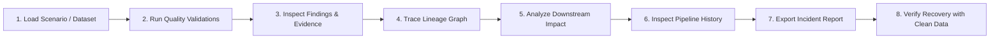
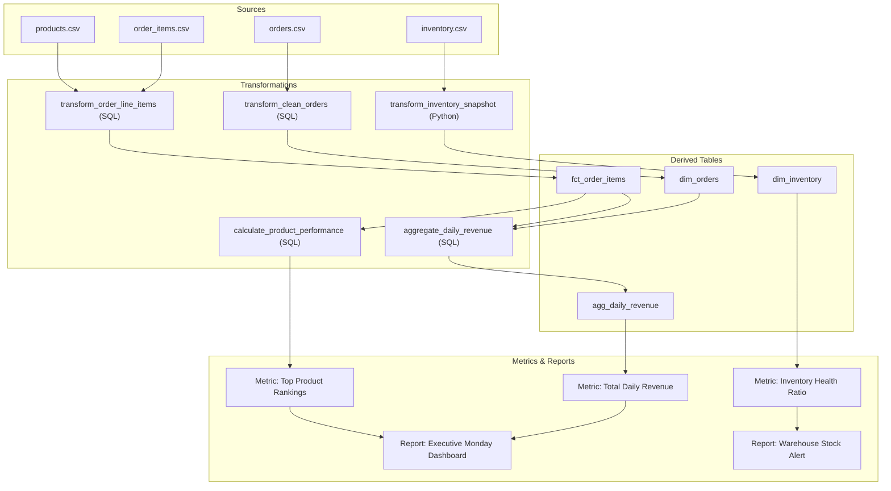

# Lux Product Requirements Document (PRD)

## 1. Product Overview & Identity

- **Product Name:** Lux
- **Repository Name:** `lux-data-observability`
- **Product Category:** Data Observability Platform
- **Primary Brand Color:** Lux Purple (`#6B46C1` / `#7C3AED` accent, balanced with neutral slates `#0F172A`, `#1E293B`, `#F8FAFC` for high-contrast accessibility)
- **Repository Description:** Lux is a data observability platform for data quality validation, lineage tracking, pipeline monitoring, and downstream impact analysis.
- **Core Investigation Workflow:** **Trace the Failure**

### The Core Problem
When an organization’s dashboards display unexpected metrics, pipelines produce corrupted outputs, or reports disagree, data teams face critical diagnostic questions:
1. *What failed?* What exact records, columns, or files violate integrity expectations?
2. *What evidence supports the finding?* Which primary keys or sample rows are broken?
3. *Where did the problem originate?* Which upstream source dataset or pipeline step introduced the corruption?
4. *Which downstream assets are affected?* Which derived datasets, metrics, and executive reports depend on the corrupted data?
5. *Is the pipeline failing mechanically, or did it execute successfully while producing bad data?*
6. *What must be verified before the outputs can be trusted again?*

Lux provides a deterministic, reproducible, evidence-based investigation platform to answer these questions without relying on opaque heuristics or speculative AI claims.

---

## 2. Intended Users & Personas

- **Data Engineers:** Investigate pipeline runs, debug source data anomalies, verify schema changes, and validate bug fixes before republishing tables.
- **Software Engineers:** Verify data ingested from microservices or third-party webhooks, catch broken foreign keys, and trace downstream impacts.
- **Data Analysts & Analytics Engineers:** Determine whether anomalous metric spikes in business intelligence tools are real trends or data quality anomalies.
- **Technical Reviewers & Evaluators:** Assess data observability principles, lineage traversal, and recovery verification through deterministic, self-contained demonstration scenarios.

---

## 3. Core Workflow: Trace the Failure

The end-to-end user journey in Lux follows eight distinct stages:

1. **Load Scenario / Dataset:** Select a bundled scenario (e.g., *Monday Revenue Mystery*) or upload a compatible dataset.
2. **Run Quality Validations:** Execute declarative validation rules across loaded datasets.
3. **Inspect Findings & Evidence:** Filter and review structured validation findings, affected record counts, and concrete row-level evidence.
4. **Trace Lineage Graph:** Open the interactive DAG to see relationships between sources, transformations, derived tables, metrics, and reports.
5. **Analyze Downstream Impact:** Select a failed check or dataset and trace downstream dependency paths to identify all potentially compromised assets.
6. **Inspect Pipeline History:** Review execution metadata, compare historical run durations, and check partition freshness.
7. **Export Incident Report:** Generate an immutable, evidence-backed incident report in JSON and sanitised HTML.
8. **Verify Recovery:** Load corrected data, rerun validations, inspect before-and-after comparisons, and verify that downstream assets are recovered.

---

## 4. Functional Requirements

### FR-01: Dataset Ingestion and Scenario Management
- **File Format Support:** Ingest CSV and JSON datasets deterministically.
- **Bundled Scenarios:** Ship with pre-configured scenarios including synthetic e-commerce fixtures (`orders.csv`, `order_items.csv`, `products.csv`, `inventory.csv`).
- **Dataset Uploads:** Support local file uploads with strict validation:
  - File size cap (default 20MB per file).
  - Explicit mime-type and header inspection.
  - Safe UUID-based isolated storage in `data/uploads/`.
- **Validation on Ingestion:** Enforce explicit error handling for missing columns, malformed delimiters, unparseable JSON, oversized payloads, and incompatible schemas.
- **Deterministic & Offline:** No dependency on external SaaS APIs, cloud object stores, or live credentials.

### FR-02: Data Quality Validation Engine
- **Deterministic Execution:** Execute validation rules against actual loaded data, not mocks.
- **Supported Rule Categories:**
  1. *Missing Required Values:* Detect nulls, empty strings, and whitespace-only cells in non-nullable columns.
  2. *Duplicate Records / Identifiers:* Primary key uniqueness and multi-column composite uniqueness.
  3. *Invalid Values and Types:* Format validation (regex), integer/float parseability, enum membership.
  4. *Referential Integrity Violations:* Foreign key checks (e.g., `order_items.product_id` referencing `products.id`).
  5. *Timestamp and Temporal Anomaly Checks:* Valid ISO timestamps, future timestamp prevention, unexpected temporal gaps.
  6. *Schema Integrity:* Missing expected columns, unexpected extra columns, altered data types.
  7. *Record-Count Anomalies:* Min/max row thresholds and expected row count ratios.
  8. *Value Range Anomalies:* Min/max numeric bounds (e.g., negative prices, negative inventory).
  9. *Freshness and Partition Monitoring:* Expected dataset partition date vs observed latest timestamp.
- **Structured Evidence Format:**
  - `rule_id`, `rule_name`, `category`, `severity` (`CRITICAL`, `HIGH`, `MEDIUM`, `LOW`, `INFO`).
  - `status` (`PASSED`, `FAILED`, `WARNING`, `SKIPPED`, `ERROR`).
  - `affected_dataset`, `affected_fields`, `affected_record_count`, `total_record_count`.
  - Representative problematic rows (keys, line numbers, observed vs expected values).
  - Execution duration and run timestamp.
- **Honest Truth Reporting:** Passing checks establish only that configured checks passed; Lux never claims a dataset is completely correct.

### FR-03: Data Lineage Explorer
- **Explicit Dependency Declarations:** Dependency graphs are built from explicit metadata declarations (`scenario.json`), not guesswork.
- **Interactive Visualization:** Interactive React Flow DAG rendering nodes:
  - `SOURCE_DATASET`: Raw files/tables.
  - `TRANSFORMATION`: Processing scripts/SQL tasks.
  - `DERIVED_DATASET`: Cleaned/aggregated staging datasets.
  - `METRIC`: Calculated business KPIs.
  - `REPORT`: Consumer dashboards and business reports.
- **Traversal Capabilities:**
  - Upstream dependency tracing (root-cause discovery).
  - Downstream dependency tracing (blast-radius discovery).
  - Node metadata inspection (schema, ownership, transformation logic, refresh cadence).
- **DAG Integrity Validation:** Enforce acyclicity (no cycles allowed), reject dangling references, and surface disconnected or missing nodes clearly.

### FR-04: Downstream Impact Analysis
- **Target Selection:** Trigger impact analysis by selecting any validation finding, dataset, or pipeline node.
- **Blast Radius Computation:** Traverse downstream directed paths to identify every derived dataset, metric, and report downstream of the selected entity.
- **Path Explanations:** For each impacted asset, explain the exact dependency chain connecting it to the failure source (e.g., `orders.csv` → `transform_daily_revenue` → `daily_revenue_summary` → `metric_total_revenue` → `monday_executive_dashboard`).
- **Classification of Impact:**
  - `CONFIRMED_FAILED`: The asset failed its own validations.
  - `DIRECTLY_AFFECTED`: Immediate downstream consumer of corrupted data.
  - `POTENTIALLY_AFFECTED`: Transitive downstream consumer in the dependency tree.
  - `HEALTHY`: No failing upstream dependencies.
- **Non-Dogmatic Causality:** Clearly document that dependency indicates potential corruption, not mathematical certainty of metric error.

### FR-05: Pipeline Observability and Run History
- **Execution Metadata:** Record run IDs, start/end timestamps, duration, compute status (`COMPLETED_SUCCESS`, `FAILED`, etc.), and step record counts.
- **Separation of Health Dimensions:** Explicitly differentiate compute execution health from data quality health.
- **Data Freshness Tracking:** Compare observed latest partition timestamps against scheduled SLA expectations.
- **Historical Run Comparison:** Store historical execution records in SQLite to allow comparing run durations, record volumes, and validation failure rates over time.

### FR-06: Incident Investigation Workflow
- **Unified Workspace:** Synthesize quality findings, lineage paths, impact blast radius, and pipeline execution logs into a structured investigation view.
- **Observation vs Hypothesis:** Explicitly separate verified facts (e.g., "5 duplicate order IDs found") from working hypotheses and recommended actions.
- **No Speculative AI Hallucinations:** Do not fabricate root causes or generate unsupported claims.

### FR-07: Reproducible Reports
- **Multi-Format Export:** Export complete incident investigations as immutable JSON and standalone HTML files.
- **Complete Evidence Package:** Include incident ID, timestamp, scenario name, validation summary, full finding details, impacted asset list, and lineage paths.
- **Zero XSS & Standalone Rendering:** HTML reports use strictly auto-escaped templates, embedded CSP headers, and inlined CSS without external dependencies.

### FR-08: Recovery Verification
- **Corrected Fixture Ingestion:** Allow users to load a clean version of the scenario dataset.
- **Rerun Validations:** Execute quality checks against clean data while retaining historical run records.
- **Before-and-After Diff:** Display clear before-and-after comparison tables indicating resolved checks, remaining warnings, and recovery of downstream assets.
- **Non-Presumptive Resolution:** The system does not mark an incident resolved solely because a single check passed; it presents verified recovery evidence to the user.

### FR-09: Usable Demonstration Workflow
- **Zero-Setup Demo:** Recruiters and evaluators can explore the entire workflow with zero configuration and zero API keys.
- **Bundled Scenario:** Pre-package the signature scenario with one-click loading and guided UI steps.

---

## 5. Signature Demonstration Scenario: "Monday Revenue Mystery"

### Storyline
At **Northstar Commerce** (a fictional multi-channel retailer), Monday morning executive dashboards show an unexpected \$142,000 revenue spike, while warehouse inventory reports show negative stock for popular SKUs. The ETL orchestration tool (Airflow/Dagster) reported `SUCCESS` for the overnight pipeline run at 02:00 UTC.

### Ingested Dataset Fixtures
- `orders.csv`: 1,250 records.
- `order_items.csv`: 3,420 records.
- `products.csv`: 250 records.
- `inventory.csv`: 250 records.

### Introduced Defects in Defective Fixture
1. **Duplicate Orders:** 15 order IDs are duplicated with identical order timestamps, artificially inflating gross revenue.
2. **Broken Foreign Keys:** 24 order-item records reference product IDs that do not exist in `products.csv`.
3. **Invalid Inventory Quantities:** 8 SKUs have negative available quantities (e.g., `-12`).
4. **Stale Partition / Temporal Gap:** Sunday transactions between 18:00 and 22:00 UTC are missing due to an upstream ingestion sync gap.

### Declared Lineage Graph

### Expected Validation Findings
| Rule ID | Category | Severity | Expected Findings |
|---|---|---|---|
| `VAL-ORD-001` | Duplicate Identifiers | `CRITICAL` | 15 duplicate `order_id` values found in `orders.csv` |
| `VAL-ORD-002` | Referential Integrity | `HIGH` | 24 `order_items.product_id` do not exist in `products.csv` |
| `VAL-INV-001` | Value Range | `HIGH` | 8 SKU inventory quantities < 0 in `inventory.csv` |
| `VAL-FRESH-001`| Freshness / Temporal Gap | `MEDIUM` | Ingestion gap between 18:00 and 22:00 UTC |

### Downstream Impact Blast Radius
- Selecting `orders.csv` or `VAL-ORD-001` highlights:
  - `dim_orders` (Directly Affected)
  - `agg_daily_revenue` (Potentially Affected)
  - `Metric: Total Daily Revenue` (Potentially Affected)
  - `Report: Executive Monday Dashboard` (Potentially Affected)

### Recovery Fixture
- `corrected/orders.csv`: Duplicates deduped.
- `corrected/order_items.csv`: Foreign keys reconciled.
- `corrected/inventory.csv`: Negative inventory reconciled.
- `corrected/pipeline_history.json`: Successful run with full freshness.
- Running recovery validation proves all checks pass (`PASSED`) and downstream assets are healthy.

---

## 6. Non-Functional Requirements

### NFR-01: Reliability & Data Integrity
- Pure deterministic validation functions; tests must yield identical results across repeated executions.
- Zero mock findings presented as real calculations.
- File operations must use transactional boundaries; failed uploads must not leave partial files or dirty database records.

### NFR-02: Security & Privacy
- **Strict Input Validation:** Uploads strictly limited to `.csv` and `.json`. Max upload size 20MB.
- **Path Traversal Protection:** Internal storage paths generated with UUIDv4; user filenames sanitized.
- **Zero Code Execution:** No arbitrary SQL, Python scripts, or template expressions executed from user data.
- **XSS-Safe HTML Reports:** Mandatory HTML entity escaping and strict CSP headers.
- **No Hardcoded Secrets:** Zero credentials or secrets in code or repository.

### NFR-03: Performance
- Validation run for 10,000 records must complete in under 500 milliseconds.
- Lineage graph traversals and impact calculations must execute in under 50 milliseconds.
- Report generation must complete in under 1 second.

### NFR-04: Accessibility & Usability
- Brand color: Lux Purple (`#6B46C1` / `#7C3AED`) adhering to WCAG AA contrast standards (minimum 4.5:1 for body text, 3:1 for UI elements).
- Status indicators must never rely on color alone (must include icons and clear text labels).
- Full keyboard navigability and semantic HTML across all views.

### NFR-05: Maintainability & Testability
- Complete separation of concerns: Ingestion, Validation, Lineage, Pipeline, Reports, API, UI.
- Test coverage targets: >90% unit test coverage for validation rules, graph traversal, and report sanitization.
- Clean Docker Compose environment running with zero external cloud dependencies.

---

## 7. Out of Scope

The following capabilities are explicitly out of scope for the initial release:
1. Production connectors to commercial cloud data warehouses (Snowflake, BigQuery, Databricks).
2. Live streaming message ingestion (Kafka, Kinesis, RabbitMQ).
3. Automatic SQL parsing for arbitrary transformation discovery.
4. Autonomous LLM/AI root-cause diagnoses or speculative text generation.
5. Multi-tenant enterprise identity management (SSO, SAML, OAuth, RBAC).
6. Real-time alerting integrations (PagerDuty, Slack bot, email notifications).

